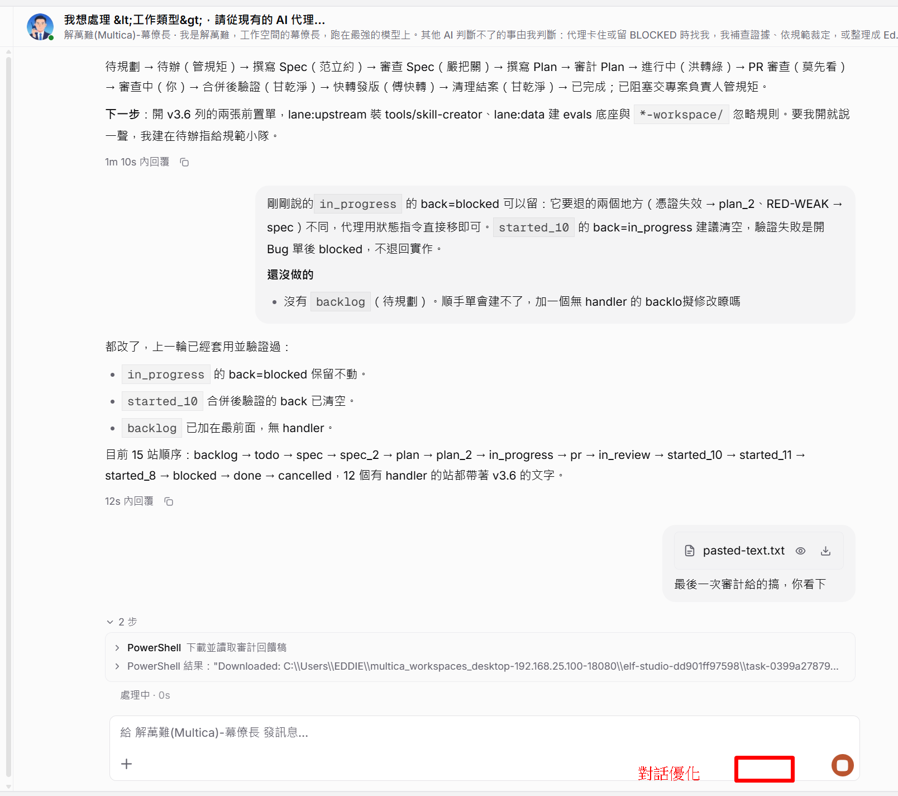
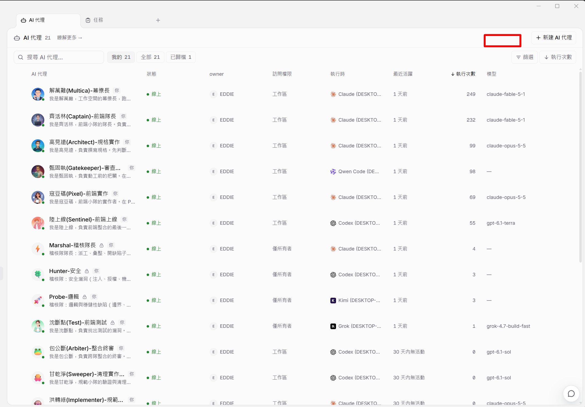
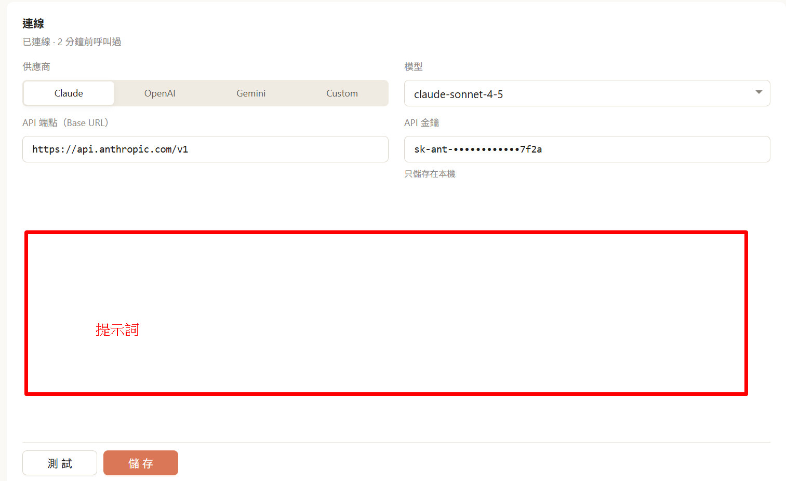

# AI 設定頁與「對話優化」按鈕
狀態：定案（2026-11-03，Eddie：「你先作」）。追蹤：Multica E-49（規格）、E-50（前後端計畫；原 E-51 已併入）。

## 目的與原因

1. **打字容易錯、意思常講不清楚。** Eddie 在聊天和留言裡回覆 AI 代理時常打錯字，句子也常表達不清楚。他要在每個能打字回覆的地方加一顆「對話優化」按鈕：AI 參考前面的對話，把他正要送出的那段文字改好。修錯字是基本，**把意思講清楚更重要**。
2. **沒有地方設定這個 AI。** 目前伺服器的「輔助 AI」（負責自動產生聊天標題、建議追問）只能用伺服器環境變數 `MULTICA_LLM_*` 設定，畫面上看不到也改不了。Eddie 要一個專門的頁面，讓管理員選供應商、模型，填金鑰和提示詞。
3. **可以用自己架的小模型。** 對話優化不需要大模型。Eddie 要能接自己架的 llama.cpp，但 llama.cpp 不放進 Multica 的預設部署，改成可選的套件，避免原作者不接受。（Eddie 決定）

## 參考畫面（Eddie 提供）

對話優化按鈕的位置（紅框，送出鍵旁）：

「AI 設定」入口（紅框，「新建 AI 代理」旁）：

設定頁版面草圖。與規格不同處以規格為準：供應商改用下拉選單、選項更多；金鑰加密存在伺服器，不是圖上的「只儲存在本機」。

## 要做

### A. 「AI 設定」頁

- **入口**：「AI 代理」列表頁右上角，「新建 AI 代理」旁邊加一顆「AI 設定」按鈕，點了開一個新頁面。「新建 AI 代理」不變（它是給工作流用的）。
- **權限**：只有工作區擁有者和管理員看得到按鈕、能進這頁、能讀寫設定。其他成員看不到這一頁，但可以使用對話優化。
- **範圍**：整個工作區共用一組設定。網頁版與桌面版都有。
- **「對話 AI」欄位**：
  - 供應商：下拉選單，選項為 Claude（Anthropic）、OpenAI、Gemini、DeepSeek、Qwen（通義）、Kimi（Moonshot）、Grok（xAI）、OpenRouter、Hugging Face、自架（llama.cpp）、自訂。
  - 選了供應商，API 端點自動帶入該家的 OpenAI 相容網址，可以改。「自架（llama.cpp）」帶入 `http://localhost:8080/v1` 當範例，「自訂」由使用者自己填。
  - 模型：下拉選單，選項跟著供應商變，也能手動輸入。
  - API 金鑰：輸入後只顯示末四碼。自架可以留空。
  - 關閉思考：勾選後請求加上 `chat_template_kwargs: {"enable_thinking": false}`，給 Qwen3 這類會先思考的模型用。行為比照現有的 `MULTICA_LLM_DISABLE_THINKING`。
  - 提示詞：多行文字框，預設內容寫好（修錯字、把意思講清楚、不改原意、不加內容、使用原文的語言），管理員可以改，也可以「還原預設」。
  - 從技能載入：可以選一個工作區技能，用它的 `SKILL.md` 內容當優化規則，取代提示詞框的內容。
  - 頁首顯示連線狀態，例如「已連線 · 2 分鐘前呼叫過」或「尚未設定」。
- **測試**：伺服器用畫面上目前的值實際呼叫一次（送一句短句），成功顯示「連線成功」，失敗顯示 HTTP 狀態碼和截短的錯誤訊息。測試不需要先儲存。
- **金鑰存放**：存在伺服器資料庫並加密，沿用 Slack、釘釘、飛書整合現有的加密做法。任何 API 都不回傳完整金鑰，只回傳「是否已設定」與末四碼。儲存時金鑰欄位沒改就不覆蓋。

### B. 「對話優化」按鈕

- **位置**：人可以打字回覆的所有輸入框，放在送出鍵旁邊：
  1. 聊天輸入框
  2. 任務留言
  3. 留言回覆
  4. 編輯既有留言
  5. 建立任務（描述欄位）
  6. 快速建立任務
- **何時顯示**：工作區的「對話 AI」已設定才顯示；輸入框是空的時候按鈕停用。
- **「對話優化」開關**（Eddie 決定）：放在「設定 → 偏好設定 → 評論與聊天」，跟同區其他設定一樣存在這台電腦。工作區沒設定對話 AI 時不顯示。預設關閉（AI 的決定）。
  - **關閉時**：照上面，在輸入框旁按「對話優化」才會優化，自己決定要不要用。
  - **打開時**：在聊天、留言、回覆三處按送出（包括按 Enter 或快捷鍵送出），一律先跳出優化視窗，不會直接送出；不小心按到送出也一樣。視窗的「送出」等於原本那顆送出鍵：先把右邊的文字放回輸入框，再走原本的送出流程，附件、要叫醒哪些代理、插話或本輪結束後等原本會一起送出的東西全部照舊，只是在視窗裡看不到。
- **優化視窗**（兩種情況共用，Eddie 決定）：
  - 上方是標題，標題列只有一個 X。只有按 X 才會關閉視窗、回到輸入框、原文不動、不送出；按 Esc、點視窗外面都不會關閉，避免順手就跳過優化。使用者可以先按 X，再去偏好設定把開關關掉。（Eddie 決定）
  - 中間分左右兩欄：左邊「優化前」唯讀，右邊「優化後」可以自己再改。
  - 背景不模糊；視窗置中，可以拖動。
  - 底部按鈕：「優化」再產生一次，不滿意可以一直按；第二顆依情況不同，開關打開時是「送出」（送出右邊的文字），手動按按鈕時是「採用」（右邊的文字換進輸入框、視窗關閉，不送出）。
  - 底部說明：「AI 代理可能會出錯。」開關打開時再加一句「如果想自己決定要不要優化，請到偏好設定 → 評論與聊天，關閉對話優化。」
  - 優化失敗時：上方顯示錯誤，可以按「優化」重試，不會被卡住。右邊若還沒有任何結果（第一次就失敗），放原文，可直接送出或採用原文；若右邊已有上一次的結果或使用者改過的字，保留不動。（AI 的決定；保留右欄內容是 Eddie 2026-11-03 決定）
  - 右邊清空、又沒有選決議時，「送出」／「採用」停用，避免把輸入框清空。（Eddie 同意）
  - 「決議」下拉另有淡色的「請決定」選項，可以取消已選的決議。（Eddie 決定保留）
- **前文**：
  - 聊天：同一個聊天的最近幾則訊息。
  - 任務留言、回覆、編輯留言：任務標題、描述，以及最近幾則留言（回覆時以該留言串為主）。
  - 建立任務、快速建立任務：沒有前文，只改輸入的那段。
- **格式**：保留 Markdown、@提及、任務編號連結、附件，只改文字內容。
- **等待中**：視窗右邊顯示載入中，這時「送出」／「採用」停用。

### B2. 決議與執行下拉（Eddie 提出，2026-11-03）

- **目的**：重要關卡（規格定案、計畫核准）用固定選項表達決定，代理與門禁一定讀得懂；就算使用者打的字有錯，選項也清楚，代理可以據此提醒。不常打英文的人也能直接選執行方式。
- **位置**：聊天、留言、回覆三個輸入框，放在「對話優化」左邊，依序是：決議下拉、執行下拉、對話優化、送出。（Eddie 決定）
- **兩件事、都是選填**（Eddie 決定）：
  - **決議**：選項 核准執行、再議討論。預設不選，顯示淡色提示字 請決定。
  - **執行**：選項 單代理執行、多代理執行，對應 Native 與 Subagent-driven。預設 多代理執行（高併發）。
  - 選項與送出的文字都不加「」、（）之類的符號。
- **不會一選就送出**：照平常打字、按送出。送出時，若有選決議，在訊息最後空一行加上：
  - 核准執行：`決議：核准執行`，下一行用 superpowers 官方技能名稱告訴代理怎麼做：多代理執行送 `Use superpowers:subagent-driven-development`，單代理執行送 `Use superpowers:executing-plans`。
  - 再議討論：`決議：再議討論`，下一行 `Do not start. Wait for further discussion.`
  - 第二行用英文官方用語，是因為這幾行是給代理看的；用中文自訂說法，別的代理工具不一定認得，等於白跑。畫面上的選項仍是中文。（Eddie 決定）
  - 沒選決議時什麼都不加（執行只跟著核准執行一起送出）。（AI 的決定）
  - 有選決議時，輸入框可以是空的，送出的內容就只有決議那幾行。（AI 的決定）
- **與對話優化的關係**：決議那幾行在優化之後才加上，不送給模型、也不會被改；優化視窗的右欄只放使用者自己打的字。（AI 的決定）
- 送出後決議回到 請決定；執行保留上次的選擇，存在這台電腦。（AI 的決定）
- 送出且有選決議時，跳一個通知「已送出決議：核准執行」（或再議討論），附「查看」，點了捲到剛送出的那則。（Eddie 決定要通知）
- 門禁：Eddie 的留言中有一整行 `決議：核准執行`，就算核准當下最新版的計畫（skillshare-source E-56）。規格定案也用同一個選項，執行方式用來決定接下來由單一代理或多代理寫計畫、做實作。
- 這兩個下拉不受工作區有沒有設定對話 AI 影響，一律顯示。

### C. llama.cpp 部署套件（可選）

- 另外提供一份可選的部署設定（例如 `deploy/llama/` 下的 docker compose 檔與說明），用 llama.cpp 的 `llama-server` 跑一個小模型，提供 OpenAI 相容端點。
- 預設的 `docker-compose*.yml` 不加 llama.cpp；要用的人自己啟動這份套件，再到「AI 設定」選「自架（llama.cpp）」填端點。
- Multica 本身不寫任何 llama.cpp 專用的程式，只認 OpenAI 相容端點。原作者的文件已經用同一種方式說明自架模型：`environment-variables` 文件的 `MULTICA_LLM_BASE_URL`，以及給 vLLM、sglang 用的 `MULTICA_LLM_DISABLE_THINKING`。

## 不做

- **嵌入與重排序這輪不做**，另開一份規格在下一輪做，做成插件：
  - 插件自帶 llama.cpp，跑 Qwen3-Embedding-4B 與 Qwen3-Reranker-4B。
  - 有新留言時，插件自動建立索引。
  - 代理透過插件提供的 MCP 工具搜尋歷史。
  - 向量存在同一台 PostgreSQL 的另一個資料庫（pgvector）。

  這部分是一個新服務，工作量不小，所以不跟這輪一起做。（「工作量不大就一起做」是 Eddie 定的原則；判斷工作量不小是 AI 的決定）
- 「對話 AI」這輪不接管自動產生聊天標題與建議追問，它們繼續用伺服器環境變數。（AI 的決定）
- 不做每個人各自的金鑰；只有工作區共用一組。
- 不改「按 Enter 送出」：已經可以在「設定 → 快捷鍵 → 傳送」選 Enter 或 Ctrl+Enter。
- 不做手機版（mobile 是獨立的 app）。

## 反目標（做到了也算失敗）

- 優化後的文字改掉使用者的原意，或加進使用者沒講的事。
- 金鑰以任何形式出現在回應、日誌或前端狀態裡。
- 非管理員能讀到或改到設定。
- 沒設定 AI 時，仍有任何對話內容被送到外部。
- 優化把 @提及、任務連結或附件弄壞。
- Multica 預設部署因為這個功能多了 llama.cpp 或模型檔。

## 限制

- 伺服器呼叫 AI 一律經過 `server/pkg/llm`（單一入口規則；有測試把關）。新增的呼叫要更新該套件註解裡的「Consumers」清單，以及 `.env.example` 與環境變數文件中對外說明送出哪些內容的文字。
- 這個套件用的是 OpenAI SDK，所以各家都走 OpenAI 相容端點。
- 新的 API 回應要經過 zod schema 與 `parseWithFallback`，並補格式錯誤的測試。
- 新資料表不加外鍵；建立索引用 `CREATE INDEX CONCURRENTLY`，一個檔案一個。
- 共用頁面放在 `packages/views`；文案補齊六種語系，並照 `conventions.zh.mdx` 檢查用語。
- 這是 fork 專屬功能，不送上游。改到上游共有檔案的地方盡量少，方便之後同步上游。

## 已決定的做法

- 入口在「AI 代理」頁、「新建 AI 代理」旁邊，獨立一頁。（Eddie 決定）
- 欄位是供應商、模型、API 端點、API 金鑰、提示詞，加上「測試」「儲存」，版面比照 Eddie 的圖。（Eddie 決定）
- 供應商用下拉選單，要放很多家，包含 Hugging Face。（Eddie 決定）
- 多人版，只有管理員有權限，整個工作區共用。（Eddie 決定）
- 對話優化以「把意思講清楚」為主、修錯字為輔。（Eddie 決定）
- 結果用左右對照的彈出視窗呈現，可重新產生到滿意再採用。（Eddie 決定）
- 聊天、留言、回覆在「對話優化」左邊加決議下拉（核准執行、再議討論，預設 請決定）與執行下拉（單代理執行、多代理執行，預設多代理），兩者選填、不會一選就送出，送出時把決議附在訊息最後。（Eddie 決定；附加格式、執行只跟核准一起送、優化不碰決議是 AI 的決定）
- 偏好設定加「對話優化」開關；打開時聊天、留言、回覆按送出一律先跳視窗，視窗的「送出」帶上原本送出的所有內容；視窗標題列只有 X、右欄可編輯、背景不模糊、置中可拖動。（Eddie 決定，2026-11-03）
- 端點可以填內網位址與 localhost（例如自架的 Qwen）。管理員可以藉「測試」從伺服器連到內網其他機器，這個風險接受，因為只有管理員能設定。（Eddie 決定）
- llama.cpp 用可選套件提供，不進預設部署。（Eddie 決定）
- 優化規則可以從工作區技能載入。（Eddie 提出。做法是 AI 的決定：讀技能的 `SKILL.md` 當提示詞，因為對話優化不是代理執行，不經過代理載入技能的流程）
- 金鑰加密存在伺服器，由伺服器呼叫 AI。（AI 的決定，依「多人版、管理員設定」推導）
- 供應商清單除 Hugging Face 以外的其他家。（AI 的決定）
- 加密金鑰：比照現有整合，新增一個伺服器環境變數 `MULTICA_AI_SECRET_KEY` 當加密主金鑰，營運者設定一次即可。沒設定時「AI 設定」頁仍可進入，但顯示「伺服器尚未設定加密金鑰」並停用儲存；對話優化按鈕不顯示。要同步更新 `.env.example` 與自架用的 docker-compose。（AI 的決定，審查者提出）
- 換供應商或改了端點的主機，一定要重新輸入金鑰，「測試」也一樣；避免把已存的金鑰送到新填的網址。（AI 的決定，審查者提出）
- 工作區設定與伺服器環境變數 `MULTICA_LLM_*` 不互相替代：工作區沒設定時對話優化就不能用，不會退回用環境變數那組；聊天標題與建議追問照舊只用環境變數。（AI 的決定）
- 「測試」失敗時只顯示 HTTP 狀態碼和截短的錯誤訊息（例如前 200 字），不原樣顯示整段回應。（AI 的決定，審查者提出）
- 「關閉思考」做成工作區設定的一個勾選欄位。（AI 的決定）

## 留給實作者決定

- 資料表結構、API 路徑與命名。
- 各供應商預設端點與模型清單的實際值。
- llama.cpp 套件預設跑哪個小模型、量化版本與下載方式。
- 「最近幾則」的確切數量與長度上限（參考建議追問的做法：6 則、每則截斷）。
- 對照視窗是否標示差異（例如標出改動的字）。
- 頁面路由：網頁版與桌面版各自接上。

## 驗收

1. 管理員在 AI 代理頁看得到「AI 設定」，一般成員看不到；一般成員直接打開該頁網址會被擋。
2. 管理員選 Hugging Face，端點自動帶入；填金鑰按「測試」顯示連線成功；儲存後重新整理，只看得到金鑰末四碼。
3. 填錯金鑰按「測試」，顯示 HTTP 狀態碼和截短的錯誤訊息，不會儲存。
4. 對話 AI 未設定時，六個輸入框都沒有「對話優化」按鈕；設定後六個都有。
5. 開關關閉時，在聊天打一段有錯字、語意含糊的話，按「對話優化」，彈出左右對照：右邊錯字修好、意思更清楚，但沒有新增原文沒有的內容；按「優化」會得到新的版本；按 X 輸入框仍是原文；按「採用」換進輸入框，沒有自動送出。
11. 開關打開時，在聊天、留言、回覆按送出（含 Enter），都先跳出視窗、沒有直接送出；在右邊再改幾個字後按「送出」，送出的是改過的文字，附件與「本次不會開始」等選擇照樣生效；按 X 則什麼都沒送出。
12. 視窗背景不模糊、置中、可以拖動；標題列只有 X；按 Esc 或點視窗外面不會關閉；底部有「AI 代理可能會出錯」與關閉開關的說明。
13. 優化失敗時，右邊是原文、上方有錯誤，仍然可以送出。
14. 在聊天、留言、回覆打一句話，決議選 核准執行、執行維持 多代理執行，按送出：訊息最後多兩行 `決議：核准執行`、`Use superpowers:subagent-driven-development`，選單上沒有「」或（）；送出後決議回到 請決定、執行仍是多代理；畫面跳出通知，按「查看」捲到該則；這則留言能讓門禁建立核准憑證。決議不選時，訊息照原樣送出、不加任何字。
6. 文字裡的 @提及和任務連結，優化後仍然可以點。
7. 用瀏覽器開發者工具看所有回應，找不到完整金鑰。
8. 照套件說明啟動 llama.cpp，「AI 設定」選「自架（llama.cpp）」、勾「關閉思考」，測試成功，對話優化可用。
9. 端點填內網位址（例如 `http://192.168.x.x:8080/v1`）能測試成功。
10. 選一個工作區技能當優化規則，優化結果照該技能的規則改。

驗收證據一律附截圖。
